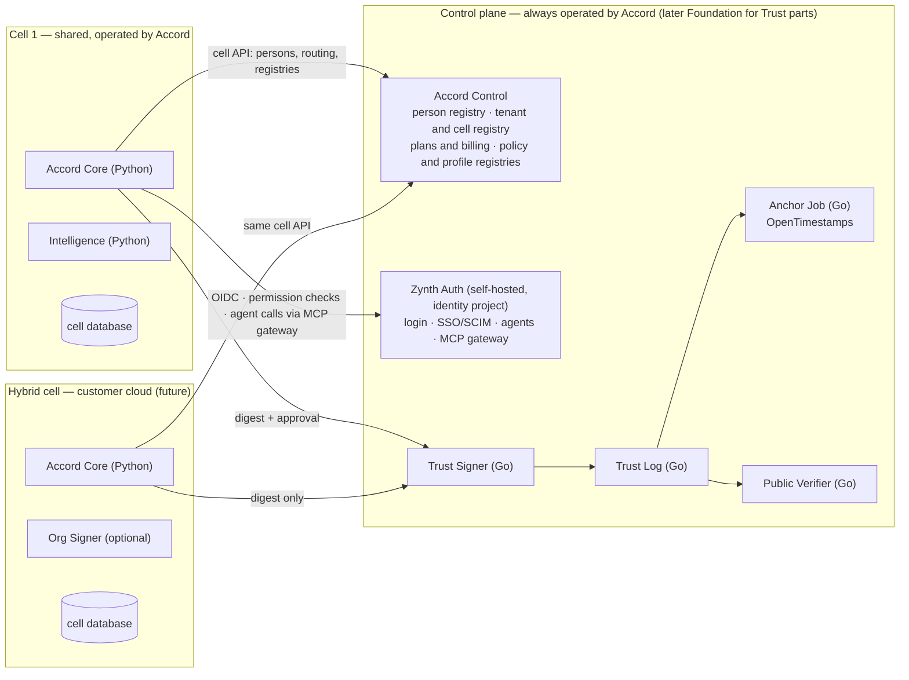

# Addendum 01 — Deployment, Identity and Trust

| | |
|---|---|
| Amends | Gen6th Accord Commercial Product and Technical Architecture v1.0 (23 September 2026) |
| Addendum version | 1.0 |
| Date | 23 September 2026 |
| Status | Approved for implementation. Revised 23 September 2026 so that §2.2, §2.3, §3, §5.1, §8, §9 and §10 match [Addendum 02](addendum-02-identity-agent-governance-zynth.md) (Zynth Auth for identity and agent governance) |
| Scope | Deployment model, control plane and cells, global personal identity, cross-organization projects, two-layer signing, transparency log, witnesses, time anchoring, public verification, open source boundary, implementation languages |

Where this addendum conflicts with v1.0, this addendum wins. Sections of v1.0 that are not mentioned here are unchanged.

---

## 1 Decision register

| ID | Decision | Replaces or extends |
|---|---|---|
| D-01 | Accord is built **hybrid-ready from day one**: a control plane operated by Accord, and data-plane **cells** that hold tenant data. The managed service is itself cell 1. | v1.0 §9, §9.3 |
| D-02 | Deployment tiers are **Accord Cloud**, **Accord Cloud Enterprise**, **Accord Hybrid** and (deferred) **Self-hosted**. Individuals are always on the managed service. | New |
| D-03 | A person's identity is **global and lives in the control plane**. Tenants hold memberships, never the identity itself. A person keeps portable proof of their own signed records after leaving an organization. | v1.0 §10.1 `identity`, §11 |
| D-04 | **Cross-organization projects** are core scope. Each party keeps its artifacts and evidence in its own tenant and cell. | v1.0 §4.2, §10 |
| D-05 | **Two-layer signing**: the claimant attests (a passkey assertion from the person and, optionally, an organization key); Accord signs as the platform; the transparency log records the digest. | v1.0 §6.1, §13 |
| D-06 | A **transparency log** operated by Accord Trust runs from the first record. It uses the open C2SP checkpoint and tile formats. | v1.0 §6.4 (daily hash-chain checkpoint) |
| D-07 | **Witness software is built and open from day 0, but external witnesses are not activated** until the triggers in §6.5 are met. | New |
| D-08 | **OpenTimestamps anchoring is enabled from day 0.** Log checkpoints get independent time proof in Bitcoin, and only a hash is published. | v1.0 §13 Timestamp |
| D-09 | The **specification, verifier libraries, transparency log and witness software are open source at launch.** Workflow product, Intelligence, connectors, enterprise features and hosting stay commercial. | v1.0 §13 Independent library |
| D-10 | **Implementation languages** (revised by Addendum 03 D-33): **Python (FastAPI)** for the backend services, **Go** for Trust services and the reference verifier, **TypeScript** for web, mobile and the browser verifier. | v1.0 §18.1 |
| D-11 | IP rights registration (copyright offices) is a **research item for later**, not in this addendum's scope. | New, see §10 |

---

## 2 Deployment model

### 2.1 Tiers

| Tier | Customer | Where tenant data lives | Keys | Availability |
|---|---|---|---|---|
| Accord Cloud (Free, Pro, Team) | Individuals, creators, small teams | Shared cell operated by Accord | Accord-managed platform key. Each person signs with their passkey. | Launch |
| Accord Cloud Enterprise | Companies, publishers, universities | Dedicated cell operated by Accord, in a chosen region | Customer-managed encryption keys (CMEK) for data at rest. Optional customer-held organization signing key. SSO and SCIM. | After first paying teams |
| Accord Hybrid | Legal, pharma, government, sealed research | Cell runs in the **customer's** cloud or network | Customer holds data, encryption keys and organization signing key. Only digests and permitted public projections reach the control plane. | Architecture now; packaging when the first qualifying customer signs (Stage 9) |
| Self-hosted / air-gapped | Defense, national institutions | Fully on premises | Customer holds everything. Log submissions and proofs sync in batches when connected. | Deferred, commercial licence only |

### 2.2 Control plane and cells

**Control plane.** Accord operates it for every tier. It owns:
- the person registry: Accord person IDs mapped to Zynth users, passkey key bindings and the record wallet
- **Zynth Auth**, self-hosted in the identity project, for authentication, organizations, SSO/SCIM, agent identity and authority, and the MCP gateway (Addendum 02)
- the tenant and cell registry, cell routing and verified domains
- plans, entitlements and billing
- the policy registry, the claim-profile registry, and the issuer and reviewer registries
- the Trust services: signer, log, anchoring and the witness coordinator
- the public verifier and the public status projection

**Cell.** One deployment of the data plane: Accord Core, Intelligence, a cell database, object storage and an event bus. A cell holds tenant workspaces, projects, claims, evidence, cases, audit events and integrations.

**Rules that keep hybrid possible without refactoring:**

1. A cell talks to the control plane **only through the versioned cell API**, even when both run in the same Google Cloud project. There are no cross-database queries and no shared in-process calls.
2. A cell sends the Trust services **digests and approval context only**, never artifact or evidence bytes.
3. Public projections are **pushed** by the cell to the control plane. The verifier never reads a cell.
4. Every record identifier is **globally unique and resolvable through the control plane**, independent of which cell created it. The verifier keeps working if a cell is shut down or a customer leaves.
5. Each tenant's data is encrypted under its **own data key**, wrapped by a key-encryption key. CMEK is then a key-configuration change, not a data migration.
6. The AI model provider, the event bus and object storage are behind thin interfaces. Vertex AI, Pub/Sub and Cloud Storage are the defaults. Multi-cloud is not built now.
7. The cell is deployed from one Terraform module. The same module later targets a dedicated cell project or a customer's cloud.

### 2.3 Day 0 physical layout

Keeping the zero-traffic baseline of v1.0 §19.1 means separating things logically now and physically later.

| Deployable | Language | Runtime | Project |
|---|---|---|---|
| Web app and BFF (Next.js) | TS | Cloud Run, min 0, behind Firebase Hosting (CDN and domain) at day 0; global load balancer and Cloud Armor at launch (Addendum 03 §2.5, §3.4) | gen6th-accord-prod |
| Accord Control | Python | Cloud Run, min 0, max 1 | gen6th-accord-prod |
| Accord Core (cell 1) | Python | Cloud Run, min 0, max 1 | gen6th-accord-prod |
| Accord Intelligence (cell 1) | Python | Cloud Run **service**, min 0, fed by Pub/Sub push (Addendum 03 §2.2) | gen6th-accord-prod |
| Upload scanner (ClamAV) | — | Cloud Run, min 0 (Addendum 03 §5.5) | gen6th-accord-prod |
| Timers and sweeps | — | Cloud Tasks queues and Cloud Scheduler (Addendum 03 §2.1, §2.3) | gen6th-accord-prod |
| Accord MCP server (cell 1) | Python | Cloud Run, min 0, max 1. Reachable only through the Zynth MCP gateway | gen6th-accord-prod |
| Zynth Auth (self-hosted) | — (vendor bundle) | Compute Engine e2-medium in a size-1 auto-healing instance group, always on | gen6th-accord-identity-prod |
| Zynth database | — | Dedicated Cloud SQL `db-f1-micro`, private IP (pending Zynth D1/D2) | gen6th-accord-identity-prod |
| Accord Trust Signer | Go | Private Cloud Run, min 0, max 1 | gen6th-accord-trust-prod |
| Accord Trust Log | Go | Private Cloud Run, min 0, **max 1 (single sequencer)** | gen6th-accord-trust-prod |
| Accord Anchor Job | Go | Cloud Run Job, run by Cloud Scheduler | gen6th-accord-trust-prod |
| Accord Public Verifier | Go | Public Cloud Run, min 0, max 2 | gen6th-accord-prod |
| Witness (W1) | Go | Built, **not deployed** | Different cloud and account (Phase 1) |
| PostgreSQL | — | One Cloud SQL instance, **two databases**: `control` and `cell_01`, with separate roles | gen6th-accord-prod |

Log state and tiles live in Cloud Storage in the trust project. The sequencer uses conditional writes and runs with a maximum of one instance. As a result, a compromise of the main application project cannot write to the log.

The control database and the cell database split onto separate instances when the first dedicated cell is created, or when load requires it.

The Accord services all scale to zero, and OpenTimestamps is free, so Accord's own baseline stays at **about USD 15–35 per month**. The self-hosted Zynth identity host and its database are always on and add **about USD 42–58 per month**, for an approved private-build total of **about USD 57–93 per month** (Addendum 02 §6.3; estimates to be confirmed in the GCP pricing calculator).

---

## 3 Identity

### 3.1 Global person identity

- A **person** exists once, in the control plane, as an Accord `person_id` mapped to a global Zynth user. Credentials (passkeys first), linked external identities and sign-in assurance live in **Zynth Auth**. ORCID linking and Accord's identity-assurance level stay with the Accord person record. Signed records carry `person_id`, never the Zynth `sub` (Addendum 02 §3).
- A **membership** links a person to a tenant with roles. Memberships live in the cell. Cells reference the person by their global identifier and never copy identity attributes as a source of truth.
- Every person gets a **personal workspace**, a tenant of type `personal` in the shared cell. It holds their own projects, claims and their **record wallet**.
- Organization memberships and organization admin roles live in Zynth (one Accord organization is one Zynth organization). Personal workspaces are personal Zynth organizations. Cells mirror memberships through Zynth webhooks (G4) and hold project memberships and roles themselves.
- **Passkey key bindings** (person ↔ credential public key, with effective period) come from Zynth passkey events and key export (G1, G4). They are signed by Accord and appended to the transparency log. Anyone can later check which key belonged to whom, and when.

### 3.2 Portability

- When a person signs a record in any tenant, the **signed envelope, manifest and log inclusion proof** are also added to the person's record wallet.
- The wallet holds proof, not restricted evidence. Access to the organization's evidence stays governed by the organization's policy.
- A charter or policy pack may limit wallet copies for confidential work. The minimum a person always keeps is a digest-level proof that they signed a given manifest at a given time.
- Ending a membership removes access to the tenant. It never removes wallet entries or changes the signed records.

### 3.3 Organizations and agents

Service accounts and registered agents remain organization-scoped and are **registered and governed in Zynth Auth**: credentials, risk bands, delegations, approvals and the kill switch. Every agent resolves to an accountable operator (v1.0 §1.4) through its Zynth delegation. Agents act on Accord only through the Zynth MCP gateway (Addendum 02 §4).

---

## 4 Cross-organization projects

- A project has one **host tenant** and any number of **participant tenants** and individual participants.
- Each party's artifacts and evidence are stored in **its own tenant and cell**. The shared project holds references, digests and per-object visibility grants.
- Participant access is granted per object and per work package, following the v1.0 visibility model (public, unlisted, restricted, private, sealed, embargoed).
- If a participant's cell is a hybrid cell, only digests and permitted projections cross cell boundaries. Content is fetched directly from the owning cell with short-lived, scoped grants, or not shared at all.
- The charter records the **rights and exit terms per party**: what each party keeps, what is licensed, and what happens to shared manifests when a party leaves.
- Each party can sign with its own organization key. A release manifest can require signatures from several parties.

---

## 5 Trust: signing and log

### 5.1 Two-layer signing (replaces v1.0 §6.1 steps 5–8)

1. Steps 1–4 of v1.0 §6.1 are unchanged: freeze, canonical manifest, SHA-256 digests, policy checks.
2. The signer sees the exact human-readable declaration and manifest summary.
3. **Claimant attestation:** the signer approves with their passkey through the **Zynth signing ceremony (G1)**. The WebAuthn challenge is derived from the manifest digest plus a signing-context digest. Zynth returns the raw assertion, and **Accord Trust verifies it itself** against the logged key binding before storing it in the envelope. A Zynth "step-up passed" statement is never accepted as the signature (Addendum 02 §5). If the organization requires it, the **organization key** (Accord-managed, CMEK or customer-held) also signs.
4. **Platform signature:** the Trust Signer signs the digest with the Accord platform key in Cloud KMS. This attests that Accord recorded this approval under this policy.
5. **Log:** the Trust Log appends the envelope digest and returns an **inclusion receipt** (signed entry timestamp and log index).
6. The signature record is written, the public projection is pushed, and `signature.issued` is emitted.

The envelope contains the manifest digest, the claimant attestation(s), the platform signature, key identifiers, the policy version and the log receipt. Canonicalization uses **RFC 8785 (JCS)**.

### 5.2 Transparency log (replaces v1.0 §6.4 checkpoint design)

- Entries include signature envelopes, status events (correction, supersession, withdrawal, revocation, expiry), passkey key bindings, key rotations and daily audit-batch roots from each cell.
- The log is **append-only** and uses the **C2SP tlog-tiles** and **checkpoint** formats, so standard tools and external witnesses can read it.
- Checkpoints are signed by a **dedicated log key**, separate from the platform signing key.
- A checkpoint is published whenever new entries exist, at most every few minutes, and at least once a day while the log is active.
- Revocation and status are log entries, so **current status can be verified**, not only read from Accord.

---

## 6 Trust: witnesses, anchoring and verification

### 6.1 Roles

| Role | Who | Checks | Sees |
|---|---|---|---|
| Log operator | Accord Trust now; Gen6th Foundation later | Appends entries, issues receipts and checkpoints | Digests |
| Witness | Independent parties (Phase 1 onward) | That each checkpoint only extends the previous one; then co-signs | Checkpoints only |
| Time anchor | OpenTimestamps (day 0); RFC 3161 authority (Phase 1) | That a checkpoint hash existed at a time | One hash |
| Verifier | Anyone | Everything in §6.4 | The record package |

Witnesses and anchors never see content and never judge claims.

### 6.2 OpenTimestamps anchoring (day 0)

- The Anchor Job submits the latest checkpoint root hash to **several public OpenTimestamps calendar servers**. It runs at most once an hour and is skipped when the log has not changed.
- Pending proofs are **upgraded** after Bitcoin confirmation, usually within hours. Completed `.ots` proofs are stored in the trust project's Cloud Storage and published next to the checkpoint they anchor.
- Every record gets independent time evidence of the form "existed no later than block N". It covers the gap before external witnesses are active.
- If anchoring fails, logging and signing continue. The record's time-anchor state shows as pending, and an alert fires.

### 6.3 Phased activation

| Phase | Trigger | Active | Verifier policy | Public label |
|---|---|---|---|---|
| **0 — Launch** | Day 0 | Claimant passkey, platform KMS signature, Accord log, OpenTimestamps. Witness software built and open, **off**. | Platform signature, inclusion proof and log checkpoint required. OTS proof checked when complete. No external witness required. | "Signed and logged by Accord · time anchored (OpenTimestamps) · not yet independently witnessed" |
| **1 — First activation** | First paying customer **or** first record used in a real dispute, whichever comes first | Add W1 (Accord-run witness on a different cloud and account, labelled as Accord-run) and an RFC 3161 timestamp authority | Adds 2 of 2 co-signatures on checkpoints | "Independently timestamped and witnessed" |
| **2 — Independent network** | Enterprise or hybrid customers, or institutional partners join | Add a public witness network, customer-run witnesses and institutional partners | Moves from 2 of 3 to 3 of 5 | Same label, witness list visible |
| **3 — Neutral custody** | Gen6th Foundation formed | Foundation operates the log; Accord submits entries | Foundation-published policy | Same |

Every policy version is published in `/.well-known/accord.json` and appended to the log. **A record is evaluated under the policy in force when it was issued**, so later policy upgrades never invalidate earlier records. When witnesses are activated, their first co-signed checkpoint covers the whole log up to that point.

### 6.4 Verification

Verification is a calculation anyone can run on a record package:

1. Manifest canonicalization and digest.
2. Artifact digests (when the verifier holds the artifacts).
3. Claimant attestation (passkey assertion), checked against the logged key binding.
4. Organization signature, if present.
5. Platform signature and key status.
6. Log inclusion proof against a checkpoint.
7. Checkpoint consistency and required witness co-signatures under the issuance-time policy.
8. Time anchor (OpenTimestamps, and RFC 3161 when present).
9. Current status from logged status events.

Results are reported **per check**, alongside the v1.0 trust dimensions. There is never a single "verified" badge (v1.0 §5.4).

| Verifier | Operator | Use |
|---|---|---|
| Accord Public Verifier | Accord (later mirrored by the Foundation) | Human-readable pages, QR links and machine manifests. **Checks run in the visitor's browser** with the TypeScript library, and the Go service only serves data. |
| Reference library and CLI (Go) | Anyone | Offline verification of exported packages, without contacting Accord |
| Browser and Node library (TS) | Anyone | Platforms, marketplaces, publishers and agents |

The Go and TypeScript libraries run the **same published test vectors** in CI. They must produce identical results.

---

## 7 Open source and commercial boundary

| Component | Licence | From |
|---|---|---|
| Accord Manifest specification, claim-profile and trust-dimension vocabulary, canonicalization profile, verifier policy format | CC BY 4.0 | Launch |
| Go reference verifier library and CLI | Apache-2.0 | Launch |
| TypeScript verifier library | Apache-2.0 | Launch |
| Transparency log (Go) | Apache-2.0 | Launch |
| Witness software (Go) | Apache-2.0 | Launch (not activated) |
| OpenTimestamps anchoring integration | Apache-2.0 | Launch |
| Test vectors | CC0 | Launch |
| Trust Signer, Control, Core, Intelligence, connectors, policy packs, enterprise features, operations | Proprietary | — |
| Self-hosted edition | Commercial licence, never open core | Deferred |

Open components live in a **separate public repository**, `accord-open`. The private monorepo consumes them as a pinned dependency. No private code or keys ever enter the public repository.

When formed, the **Gen6th Foundation** is intended to hold the specification, the transparency log and witness coordination, the independent appeal roster and the issuer registry. Accord remains the commercial operator. Legal structure is to be decided with counsel.

---

## 8 Code structure (replaces v1.0 §18.1; revised by Addendum 03 D-32/D-33)

**Private monorepo `gen6th-accord`**, generated from the `zynth-setup` template (Addendum 03 §12). The template's top-level layout (`backend/`, `frontend/`, `docs-site/`, `scripts/`, `tests/guards/`) is kept so its guards work unchanged. Accord adds `trust/`, `mobile/`, `contracts/` and `infra/`.

| Path | Language | Contents |
|---|---|---|
| backend/accord/control | Python | Control-plane API: person registry and Zynth mapping, key bindings, record wallet, tenant and cell registry, billing, registries |
| backend/accord/core | Python | Cell API: Collab, Claims, cases, notifications, outbox |
| backend/accord/domain/collab, backend/accord/domain/claims | Python | Domain entities, commands, state machines |
| backend/accord/policy | Python | Versioned policy evaluation and reason codes |
| backend/accord/mcp | Python | Accord MCP server, reachable only through the Zynth MCP gateway |
| backend/accord/intelligence | Python | Vertex AI service (Pub/Sub push) |
| backend/accord/fingerprint | Python | Content fingerprints: perceptual hashes and text shingles (Addendum 03 §9) |
| backend/accord/spine | Python | Template compliance spine (telemetry registry, audit, detections), with its transport on the Pub/Sub outbox (Addendum 03 §12) |
| backend/accord/cellsdk | Python | Versioned cell ↔ control-plane client |
| backend/migrations/control, backend/migrations/cell | Python (Alembic) | Two migration environments, one per database |
| frontend | TS | Next.js public site, authenticated app and BFF, verifier pages (Addendum 03 §2.5) |
| docs-site | TS | Public documentation (`/docs`) |
| mobile | TS | iOS and Android apps (Expo / React Native) (Addendum 03 §4) |
| trust | Go | Trust Signer, Trust Log, Anchor Job and Public Verifier (`trust/cmd/*`); depends on `accord-open` Go modules |
| contracts | JSON Schema | Manifest, event and cell-API schemas, the language-neutral source of truth. Generates Pydantic models, TS types and Go types. The backend's OpenAPI generates the typed TS client for `frontend` and `mobile` |
| infra/terraform/org | HCL | GCP organization, folders, org policies, state bucket |
| infra/terraform/control | HCL | Control-plane resources |
| infra/terraform/cell | HCL | Reusable cell module (shared, dedicated, and later customer cloud) |
| infra/terraform/trust | HCL | Trust project, KMS, log storage, scheduler |
| infra/terraform/identity | HCL | Identity project: Zynth VM and auto-healing instance group, Cloud SQL, Secret Manager, backup bucket, uptime checks |

The Python services are **one backend codebase deployed as several Cloud Run services** (Control, Core, MCP server, Intelligence), each with its own entry point, service identity and database role. This keeps the template's single-package guards while preserving runtime separation.

**Public repository `accord-open`**

| Path | Language | Contents |
|---|---|---|
| spec/ | — | Manifest, profiles, trust dimensions, canonicalization, verifier policy |
| go/verify, go/cmd/accord-verify | Go | Reference verifier library and CLI |
| go/tlog | Go | Transparency log (sequencer, tiles, checkpoints) |
| go/witness | Go | Witness |
| go/anchor | Go | OpenTimestamps anchoring and upgrade |
| ts/verify | TS | Browser and Node verifier |
| testvectors/ | — | Shared conformance vectors |

---

## 9 Changes to v1.0 by section

| v1.0 section | Change |
|---|---|
| §2.2 Domain ownership | Person identity moves to the control plane. The public status projection is pushed by cells to the control plane. |
| §6.1 Signing pipeline | Steps 5–8 replaced by §5.1 (two-layer signing and log receipt). |
| §6.3 Public verification | Extended by §6.4: browser-side checks, per-check results, issuance-time policy. |
| §6.4 Tamper evidence | Daily Merkle root replaced by the continuous transparency log (§5.2). Cell audit batch roots are still logged daily. |
| §9.1 Deployables | Adds Accord Control, Trust Log, Anchor Job, the Accord MCP server and the self-hosted Zynth identity host (§2.3). |
| §9.2 Modular monolith | Unchanged inside a cell. The control/cell seam is added. |
| §9.3 Projects | Adds `gen6th-accord-identity-prod` and `-nonprod` (Zynth) and a backup project now; dedicated cell projects later; customer clouds for hybrid. |
| §10.1 Schemas | Credentials, groups, service accounts, agents and delegations move to Zynth Auth. The person registry, key bindings, record wallet, directory, billing and registries move to the `control` database. `collab`, `claims`, `policy` evaluations, `audit`, `integration` and tenant workspace settings stay in the cell database. A `federation` schema is added to the cell for cross-organization project links. |
| §11 Identity | Replaced by §3 and Addendum 02: Zynth Auth for authentication, organizations and agents; Accord person registry, key bindings and record wallet. |
| §13 Cryptography | Adds RFC 8785 canonicalization, passkey attestation, dedicated log key, OpenTimestamps, and later RFC 3161 and witnesses. |
| §18 Implementation sequence | Updated in §9.1 below. |
| §18.1 Code structure | Replaced by §8. |
| §19 Cost | Accord baseline about USD 15–35. With the Zynth identity host, the approved private-build total is about USD 57–93 per month (§2.3, Addendum 02 §6.3). |
| §20 Launch gates | Additions in §9.2 below. |
| Appendix B | Adds Person, Credential, Key binding, Membership, Record wallet entry, Cell, Project connection, Log entry, Checkpoint, Witness co-signature, Time anchor proof, Verifier policy. |
| Appendix C | Adds `person.*`, `keybinding.*`, `cell.*`, `project.connection.*`, `log.checkpoint.published`, `anchor.confirmed` and `witness.cosigned` events, plus the cell API group. |

### 9.1 Implementation sequence (updates v1.0 §18)

| Stage | Additions from this addendum |
|---|---|
| 1 Platform foundation | Control/cell split, two databases, cell API and `cellsdk`, person registry, cell routing, per-tenant data keys, public repository and CI for `accord-open`. **Identity:** Zynth self-hosted in the identity project, OIDC login, person ↔ Zynth mapping, personal organizations, G3 default install and G4 webhook sync, Stage A availability and backups (Addendum 02 §6). |
| 2 Collab core | Personal workspaces, host and participant tenants, project connections, per-party visibility grants. |
| 3 Contribution and review | Contributions attributed to global persons across tenants. Accord MCP server behind the Zynth gateway, the `accord:*` permission vocabulary, agent approvals (G5), and AI-draft adoption through the content-hash lane (G6). |
| 4 Claims core | Claimant passkey attestation through the Zynth signing ceremony (G1), verified by Accord Trust. Record wallet. |
| 5 Trust and verification | Transparency log, log key, OpenTimestamps Anchor Job, envelope v1, Go and TypeScript verifiers, browser verification, test vectors, witness built and disabled, `/.well-known/accord.json`. |
| 6–8 | Unchanged, plus the launch gates in §9.2. |
| **9 Hybrid packaging and witness activation** (new; triggered) | Customer-cloud cell packaging, upgrade channel, organization signer for customer-held keys, CMEK. Phase 1 witness activation when its trigger is met. |

### 9.2 Additional launch gates and acceptance criteria

1. A record created in cell 1 verifies with the **open CLI offline**, and with the browser verifier, with identical results.
2. Every log checkpoint older than 24 hours has a **completed OpenTimestamps proof**, or an alert has fired.
3. A **cell isolation test** shows that no cell role can read the control database or another tenant's data, and that the trust project cannot be written from the prod project.
4. A **portability test**: a person leaves an organization and can still present and verify their record-wallet proofs.
5. A **cross-organization test**: two tenants co-sign a release, and neither can read the other's restricted evidence.
6. The verifier shows the Phase 0 label honestly and never implies independent witnessing.
7. The `accord-open` repository builds from a clean checkout and passes all test vectors.
8. Identity gates from Addendum 02 §8:
   - Zynth G1–G4 delivered.
   - Stage B availability in place (two Zynth hosts; Cloud SQL with regional high availability).
   - Zynth restore drill passed.
   - An identity-outage drill shows public verification unaffected and all writes failing closed.

---

## 10 Open items and research backlog

| Item | Owner | When |
|---|---|---|
| IP rights registration research: US Copyright Office, IPOPHL, WIPO requirements, AI-disclosure rules, electronic filing, where Accord's evidence package helps | Research | After the next feature round (user decision) |
| Confirm the Tessera storage backends. Keep the C2SP-compatible log on Cloud Storage for Phase 0 unless Tessera fits the cost baseline. | Engineering | Before Stage 5 |
| Select the OpenTimestamps client library (Go) and the calendar server set | Engineering | Stage 5 |
| Confirm the acceptance policy of public witness networks | Engineering | Before Phase 2 |
| Legal weight of passkey attestations as electronic signatures (Philippine E-Commerce Act and target jurisdictions) | Counsel | Before launch |
| Pricing and packaging for Free, Pro, Team and Enterprise | Commercial | Before Stage 8 |
| Capture plugins for creative and developer tools (Figma, Adobe, VS Code, DAWs, Docs) | Product | Next feature round |
| Gen6th Foundation structure and trademark licensing | Counsel | Before Phase 3 |
| ~~Primary GCP region~~ **Decided:** asia-southeast1 (Singapore), ADR-0017 | Founder | Done |
| Zynth replies to G1–G6 and D1–D10 ([requirements](../requirements/zynth-requirements-from-accord.md)) | Zynth | Before Stage 1 |
