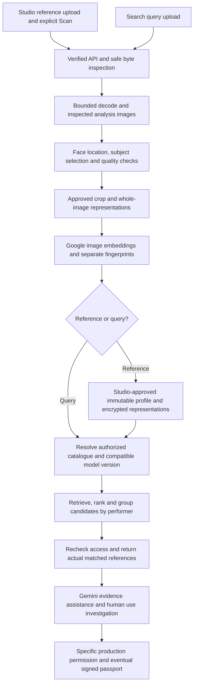

# Synthetic-performer capture and search — Google reference architecture

**Direction approved:** October 5, 2026, Asia/Manila. **Owner:** Albert Alcance.
**State:** documentation/reference design; no cloud deployment, model, index or recognition run.
See [industry objective](synthetic-performer-industry.md), [ADR-0048](../decisions/0048-synthetic-performer-identity-and-search.md)
and [as-built](../architecture/current-state.md) for scope and current implementation.
The [delivery slices](capture-search-slices.md) now start with S1 exact-file search in source;
facial representations, similarity serving and actual Google processing remain subsequent work.

## 1. The technical proposition

The owner emphasized that the capture/search technology and meaningful use of Google's stack,
in addition to the concept, must carry the hackathon demonstration. Show how pixels become a
versioned searchable performer profile, how a query retrieves authorized evidence and how the
result connects to production permission. Do not present a service-logo diagram as implementation.

The proposed contribution is an integrated system: approved reference enrollment, reproducible
face processing, complementary visual representations, scoped search, measurable uncertainty,
evidence review and use clearance. No new proprietary recognition algorithm is claimed.

The official [judging criteria](https://aibuildercup.com/themes.html) allocate 40% to Technical
Merit & Gen AI Implementation. The technical demonstration must include working Google AI
integration and the required cloud-hosted prototype, after separately authorized activation.

## 2. Capture to serving

Every box describes a required target. S1–S7 now prepare detection/representation, durable jobs,
private search and clearance source; [S7 runtime](google-runtime-slice.md) still needs actual acceptance. Enrollment can be staged pending studio
approval; query results never enroll themselves. Safety failure prevents downstream processing;
poor quality or unavailable analysis produces an honest failed/limited outcome, not search ready.

## 3. Proposed Google responsibilities

| Stage | Proposed service | Concrete responsibility and remaining proof |
|---|---|---|
| API and bounded processing | Cloud Run | Host verified FastAPI/UI integration and private Linux processing workers; prove actual resource limits and safe concurrency |
| Durable asynchronous work | Cloud Tasks to private Cloud Run | S7 prepares committed intent, verified OIDC delivery, scoped references, bounded attempts/reconciliation and atomic completion; restart/IAM acceptance pending |
| Locate the face | Cloud Vision face detection, or evaluated container detector | Candidate face regions/landmarks/quality observations; synthetic-face suitability needs evaluation |
| Visual representations | Google multimodal embeddings through the supported model API | Embed inspected face crops and whole images; validate dimensions/finite values and pin processing/model provenance |
| Evidence reasoning | Gemini | Structured evidence gaps and supported review summaries with validated references; no autonomous approvals |
| Records and profile state | Cloud SQL PostgreSQL | Immutable versions, approved references, encrypted representations, job/result state and use records under confined roles |
| Larger indexed catalogue | Cloud SQL pgvector or Google Vector Search | Optional scale path after exact-search baseline; evaluate recall, privacy, filtering and lifecycle behavior |
| Artifact storage | Existing encrypted payload store initially; Cloud Storage as a reviewed cloud option | Private originals/derivatives/evidence with explicit lifecycle; no public original route or unreviewed storage migration |
| Key protection and issuance | Cloud KMS | S6 signing/trust and S7 context/CRC envelope wrapping are prepared; retained Vault reads are explicit. Actual key/IAM lifecycle acceptance remains gated |

Google [Cloud Vision detects faces](https://docs.cloud.google.com/vision/docs/detecting-faces),
but its guide explicitly says specific-individual facial recognition is unsupported. It cannot
be advertised as the service that identifies our actor. Recognition comes from the evaluated
representation and comparison pipeline. Retain only observations needed for subject/quality
processing; do not infer real-human demographics, emotions or identity claims.

Google's [embedding guide](https://docs.cloud.google.com/gemini-enterprise-agent-platform/models/embeddings/get-multimodal-embeddings)
documents image-based vectors and currently lists `gemini-embedding-2` and
`multimodalembedding@001`. These are candidate baselines, not selected dependencies. General
visual embeddings must demonstrate face discrimination across synthetic performer appearances;
a licensed face-specific encoder may run in an approved worker if the baseline is inadequate.

## 4. Enrollment implementation contract

1. The verified API authorizes the studio, bounds input and validates digest/type/length/replay.
   Preserve the original-scan → bounded decode → derivative-scan pipeline and immutable attachment.
2. A durable analysis request names the authorized image/version and processing configuration.
   Persist job intent before dispatch. A dispatcher reconciles committed jobs if task creation
   fails; queue delivery alone is not durable completion proof. Use scoped references, not image
   bytes, tokens, prompts or private evidence in queue/log payloads.
3. The private worker loads only authorized bytes, validates bounded decoding on Linux, locates
   faces and obtains explicit selection when ambiguous. Server-side selected-region validation
   prevents client assertions from standing in for analysis.
4. Generate dedicated pixel-only analysis derivatives. Current 320-pixel thumbnail output is
   insufficiently evaluated; select analysis resolution through the synthetic-face benchmark.
   Store crop/normalization recipe and digests; inspect persisted/generated artifacts as required.
5. Generate representations through the selected model and independent fingerprint algorithms.
   Reject empty/non-finite/wrong-size vectors and incompatible responses. No invented successful
   fallback when the provider fails. Keep feature extraction and human-readable descriptions separate.
6. Bind references, representations and analysis results to immutable version/source digests.
   The studio confirms canonical enrollment. Store keys/versions outside plaintext source/logs;
   commit complete state atomically or retain explicit pending/failed state.
7. Mark search ready only when the compatible profile is available to the chosen search path.
   Replay cannot duplicate profiles; model changes produce new analysis generations. Recovery
   must preserve old version evidence and remove stale serving eligibility without rewriting history.

Cloud Tasks supports [authenticated asynchronous Cloud Run processing](https://docs.cloud.google.com/run/docs/triggering/using-tasks).
Accord still must implement job authorization, durable dispatch/reconciliation, replay, failure
handling and permitted worker data access. No queue or asynchronous analysis route exists now.

## 5. Query and result-serving contract

1. Authenticate and resolve the allowed studio/shared/opt-in catalogue before retrieval.
   Process the query with the same inspected pixel/crop/model recipe used for enrollment.
2. Check exact-file digests separately. Compare perceptual fingerprints and embeddings only
   against compatible model/processing generations. A numerical distance is not an identity probability.
3. For the bounded prototype, recommend exact comparison of a capped, authorized reference set
   inside the trusted service. Persist private vectors encrypted, decrypt only that permitted set
   for the comparison, and keep query/plaintext vectors out of logs and public responses.
4. Use model-appropriate similarity and evaluate face-only, scene-only and combined ranking.
   Do not hard-code arbitrary weights or treat many reference views as independent votes.
   Group by performer, retain the actual best supporting references and allow an inconclusive result.
5. Recheck current access/source eligibility before returning candidates and thumbnails.
   Result receipts bind query digest, catalogue/scope revision, model generation and reference
   versions. Session loss or changed permissions clear pending/late results.
6. Return bounded authorized references with separate signal labels, quality limitations,
   search coverage and completed/failed analysis state. Permit human side-by-side investigation
   and permission checks. No automatic copying accusation or enrollment of a discovered image.

Exact comparison supplies a reference result for evaluating a later approximate index. Google
[Cloud SQL supports stored vectors and pgvector queries](https://docs.cloud.google.com/sql/docs/postgres/generate-manage-vector-embeddings).
Generate image embeddings in the image-model worker: Cloud SQL's documented SQL embedding
function generates text embeddings and is not our image-ingestion API.

Ordinary pgvector/index services need search-readable numerical vectors; they cannot compare
application-encrypted vector ciphertext. A future searchable-vector design must explicitly
reconcile storage-layer encryption, role isolation, access before ranking and derived-data policy.
Do not silently replace the approved private encryption boundary. Shared opt-in references may
support a separate approved index without exposing studio-private representations.

Google [Vector Search filters](https://docs.cloud.google.com/gemini-enterprise-agent-platform/build/vector-search/filtering)
can constrain candidate sets, but filters are not independent authorization. Trusted services
must construct them from verified permissions; private/direct browser index access is not granted.
Approximate-search accuracy, stale index removal and cross-scope isolation need their own tests.

## 6. Protection, operability and Google integration gates

S7 prepares a Cloud KMS adapter for [envelope encryption](https://docs.cloud.google.com/kms/docs/envelope-encryption):
wrap per-object data keys with authenticated context and CRC32C; separate wrapping and signing
CryptoKeys. Existing Vault data uses an explicitly retained adapter. Reviewed configuration,
retained keys, permissions and recovery proof precede activation; selecting Google does not
activate or replace today's provider. See [ADR-0055](../decisions/0055-google-durable-runtime.md).

Retain Zynth as the verified human identity boundary. Cloud service identities and IAM control
service-to-service access; they do not replace creator/reviewer authorization. Bound processing
time, memory, input/output, concurrency, catalogue size and request cost. Preserve server event,
detection, audit and compliance coverage for every new action. Metrics omit images/private text.

Before any live run select exact models/SDKs/detector licenses and supported input contracts;
verify regional availability, privacy, service identities, quotas, billing limits and key lifecycle.
asia-southeast1 remains the established target region; no silent region/provider substitution.
No package install, migration/index/grant, cloud provisioning or deployment is authorized here.

## 7. What the judges should see

- Register an original synthetic actor with inspected, approved references; show actual face
  selection/quality analysis and a completed profile tied to its processing provenance.
- Search an unseen altered or regenerated appearance; show a correct candidate and supporting
  reference. Demonstrate an unrelated lookalike and an absent-performer query too.
- Show scope isolation, an inadequate-image outcome, provider failure/retry and no duplicate
  profile/clearance after replay. UI stages follow actual work, not artificial animation.
- Use Gemini to organize the supplied evidence into a source-grounded review; a human decides
  whether the appearance/use is supported. Link the exact performer version to production permission.
- Verify the issued package and demonstrate altered-package rejection after signing is active.
- Present held-out counts and retrieval/false-match/quality/failure results plus observed latency,
  request/cost totals and scope. Compare whole-image versus face-centered baseline performance;
  explain the chosen model/index from measured evidence rather than marketing scores.

These are acceptance targets, not results. [The benchmark](matching-benchmark-plan.md) governs
measurement. Reliable recognition and cohesive Google integration are the technical proof of
the future-industry vision. Broad web monitoring remains a later discovery layer.
